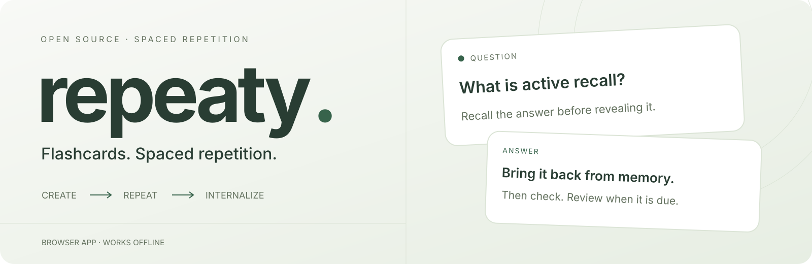

<picture>
  <source media="(prefers-color-scheme: dark)" srcset="docs/media/readme-hero-dark.svg" />
  <source media="(prefers-color-scheme: light)" srcset="docs/media/readme-hero-light.svg" />
  
</picture>

<p align="center">
  <a href="https://www.krahsu.top/repeaty/">在线体验</a> ·
  <a href="docs/USAGE.md">使用指南</a> ·
  <a href="docs/SELF_HOSTING.md">自行部署</a> ·
  <a href="docs/PLUGINS.md">编写插件</a>
</p>

<p align="center">
  <a href="https://github.com/KraHsu/repeaty/actions/workflows/ci.yml"></a>
  <a href="LICENSE"></a>
</p>

Repeaty 是一个开源的网页记忆卡片工具。把想记住的内容做成卡片，按 FSRS 安排复习。

可以直接在浏览器中使用，也可以安装桌面版，或部署带账户的 Rust + SQLite 服务。纯前端版与桌面本地模式无需注册，没有订阅或付费功能。


## 开始使用

打开 **[Repeaty 在线版](https://www.krahsu.top/repeaty/)**，点击「开始复习」即可。默认的入门卡组有 24 条笔记、27 张卡片，一边介绍 FSRS，一边带你试用评分、挖空、公式、图片和音频。支持 English / 中文（简体）。

已有自己的材料？创建卡组并添加卡片，或从 Anki `.apkg`、CSV / TSV 导入。复习时先回答，再翻面，按实际表现选择「重来 / 困难 / 良好 / 简单」。

在线版由 GitHub Pages 托管，数据只保存在当前浏览器。换浏览器或清理网站数据前，请在「数据与备份」中导出 `.repeaty` 文件。

## 功能

- **制卡**：正反面、双向、挖空；Markdown、带样式的 HTML、按语言高亮的代码块、数学公式、图片和音频。正文左对齐，图片、独立公式和表格默认居中。
- **复习**：FSRS 调度，按卡组设置目标记忆保留率和每日学习量；查看新卡、学习中和待复习数量。支持暂停、暂缓、顽固卡标记，以及复习中添加、编辑和删除笔记。按 `Ctrl / ⌘ + Z` 撤销最近操作，按 `?` 查看快捷键。
- **整理与练习**：标签、组合搜索、常用筛选、批量编辑；专项练习可选择是否更新复习进度。
- **阅读与摘录**：保存文本 / Markdown 原文，记住位置，支持筛选、批量安排、撤销和多级摘录。可按理解反馈自适应安排下次阅读，在混合学习中穿插卡片复习。[使用说明](docs/SOURCES.md)。
- **数据导入导出**：Anki `.apkg` 导入问答、双向和挖空卡及媒体，先预览，已有笔记可逐条比较和更新并保留进度；支持 CSV / TSV，`.repeaty` 备份包含附件和进度，三个版本之间可以迁移。
- **插件**：部署时安装，在设置中开关。所有版本内置答题历史圆球，可设置显示条数和翻面后显示；桌面版另内置 LeetCode 题目与判题，独立练习历史保存历次代码、结果和评分，随备份迁移。
- **MCP**：桌面版支持连接 Codex、Claude Code 和 Claude Desktop，查询学习库；主动分享摘录后，可接收制卡草稿，保存未完成的编辑，重启后继续确认。[连接说明](docs/MCP.md)。

不使用 MCP 时，可从「设置 → AI 制卡」复制说明或下载 [制卡 skill](public/skills/repeaty-cards/SKILL.md)，将材料交给 AI 生成 CSV，再在 Repeaty 中预览并导入。通用设置也可分别配置各级通知是否弹出。

目前不支持 Anki 进度迁移、自定义字段 / Anki 卡片模板、图片遮挡或个人 FSRS 参数训练。[Anki 导入范围](docs/ANKI.md) · [完整用法](docs/USAGE.md) · [存储与性能](docs/DEVELOPMENT.md#大数据量存储)

## 自行部署

|          | 纯前端版         | 带后端版          | 桌面版                       |
| -------- | ---------------- | ----------------- | ---------------------------- |
| 存储     | 浏览器 IndexedDB | 每账户独立 SQLite | 本机 IndexedDB，可连接上游   |
| 账户     | 无               | 用户名、密码      | 本地无需账户；连接上游时登录 |
| 离线     | 支持             | 需要连接服务      | 本地库支持                   |
| 插件     | 纯前端           | 纯前端            | 纯前端、本地插件             |
| LeetCode | 不包含           | 不包含            | 内置，登录信息留在本机       |

需要 Node.js 24.15+（24.x）；后端另需 Rust 与 C 编译工具。CI 使用 Rust 1.97.1。

```bash
git clone https://github.com/KraHsu/repeaty.git
cd repeaty
npm ci
```

**纯前端版**：构建后将 `dist/` 上传到静态托管。

```bash
npm run build
# 部署在子路径时，例如 /repeaty/：
VITE_BASE_PATH=/repeaty/ npm run build
```

**带后端版**：默认在 `http://127.0.0.1:8080` 提供服务，账户与各自的学习库写入 `data/`。

```bash
npm run build:server
cargo run --release --locked --manifest-path server/Cargo.toml
```

**桌面版**：从 [Releases](https://github.com/KraHsu/repeaty/releases) 下载安装包，或在安装 [Tauri 2 系统依赖](https://v2.tauri.app/start/prerequisites/)后构建。尚未发布的构建可在 [Desktop 工作流](https://github.com/KraHsu/repeaty/actions/workflows/desktop.yml)中获取。

```bash
npm run desktop:build
```

默认使用本地库，右上角「设置」可指定上游服务地址。本地库与账户库各自保留，不自动合并。

[后端部署与旧库迁移](docs/SELF_HOSTING.md) · [桌面版说明](docs/DESKTOP.md) · [LeetCode 配置](docs/LEETCODE.md)

## 开发与贡献

新版本合并到 `main` 后，核心检查与三平台构建全部通过才会自动发布 Release，附安装包和 SHA256 校验文件；同版本的后续提交不覆盖已发布产物。[发布流程](docs/RELEASING.md)

正在准备 v1.0.0。用户另行授权的 0.27.0 范围是内容渲染、内嵌 HTML、撤销与快捷键、弹窗和复习菜单；完成后继续冻结其他新功能，仅处理发布准备和修复。[发布清单](docs/RELEASE_1_0.md)

[工作目录模式与旧库迁移方案](docs/WORKSPACE_MODE.md)记录后续架构讨论，尚未实现；当前版本的存储与使用方式不变。

前端使用 Vue 3、TypeScript 和 Vite；后端使用 Rust、Axum 和 SQLite，调度使用 [ts-fsrs](https://github.com/open-spaced-repetition/ts-fsrs)。

```bash
npm run dev                      # http://127.0.0.1:5173
npx playwright install chromium  # 首次运行浏览器测试前安装
npm run check                    # 格式、单元测试、构建、浏览器测试
npm run check:server             # Rust 与后端版检查
npm run test:e2e:desktop         # 桌面界面与本地插件交互测试
```

欢迎提交 Issue 和 PR。报告问题时，请附上复现步骤、浏览器版本和报错；修改功能时，一并更新相关测试和文档。

[开发文档](docs/DEVELOPMENT.md)介绍代码结构、测试与性能基准。[插件文档](docs/PLUGINS.md)包含显示题目、显示答案接口和插件示例。PR 通过检查后合并；`main` 自动部署纯前端版到 GitHub Pages。

## License

[MIT](LICENSE) © 2026 CharlesHsu
